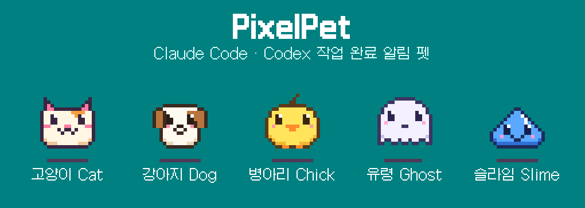
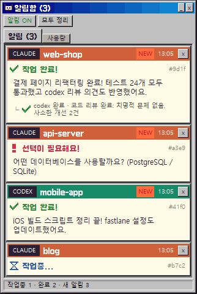
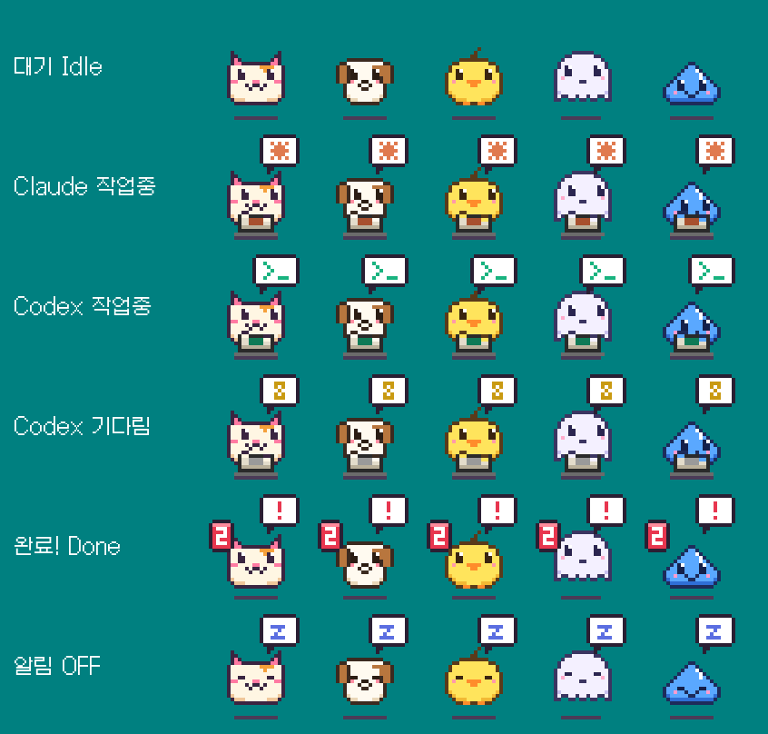
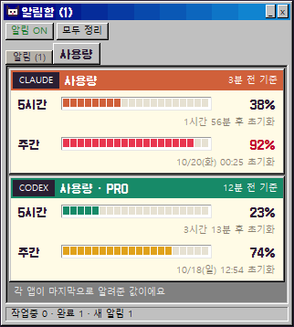

<p align="center"></p>

<p align="center"><a href="README.md">한국어</a> · <b>English</b></p>

# PixelPet

A Claude Code plugin that puts a **90s-style pixel pet** in the corner of your screen and lets you know
when Claude Code or Codex finishes its work. Every session gets its own notification card, and when Claude
hands work off to Codex, you get **a single notification once everything — including the Codex work — is done**.

<p align="center">
&nbsp;&nbsp;&nbsp;</p>

> **Windows only** (Windows 10/11, Windows Terminal recommended). The UI text is in Korean.

## Features

- 🐱 **11 pixel pets**: cat · dog · chick · ghost · slime + WIBEE FRIENDS (Wibee · Dalbo · Bombom · Dugi · Cu · Puding) (right-click → 펫 고르기 / choose pet)
- 💻 **Working indicator**: a little laptop appears and the pet types away. The logo and speech bubble show who is working
  (Claude = orange `✳`, Codex = green `>_`, plain commands = blue `$_`, Claude waiting for Codex = hourglass)
- 🔔 **Per-session cards**: each card shows the session name (conversation topic). Up to 5 are visible; expand to scroll through all of them
- ⌨️ **Plain commands too**: commands Claude runs with its Bash/PowerShell tools for 10s+ (background servers included) show as a `$` line under that Claude card, no setup needed.
  Commands in your own PowerShell windows get their own cards (with done/failed alerts) after `/pixelpet:shell`
- ❗ **Input-needed alerts**: permission prompts, multiple-choice questions, Codex approval requests
- 🧩 **Claude → Codex sub-tasks**: Codex runs started by Claude are attached under that Claude card
- ↗️ **Click to jump**: clicking a card brings that Claude Code terminal window/tab to the front
- 📊 **Usage tab**: how much of your Claude and Codex 5-hour / weekly plan limits you've used, and when they reset
- 🎵 Chiptune sounds, notifications on/off, clear all, collapse/expand, start with Windows

<p align="center"></p>

## Install

**Requirements**: Windows, [Python 3](https://www.python.org/downloads/) (check *Add python.exe to PATH*; includes tkinter), Claude Code

In Claude Code:

```
/plugin marketplace add gustjr7879/pixelpet-hyunskki
/plugin install pixelpet@pixelpet-hyunskki
```

Restart Claude Code and the pet appears. On first run it also registers itself to start with Windows
(you can turn that off from the right-click menu).

### Connect Codex too (optional)

Run once in Claude Code:

```
/pixelpet:codex
```

Then open `codex` once in a terminal and **approve (trust) the PixelPet hooks** in the hook review screen.
Codex only runs hooks you have approved. Until then, no Codex notifications arrive.

### Show PowerShell commands too (optional)

To also track ordinary scripts and builds (`python train.py`, `npm run build`, ...), run once:

```
/pixelpet:shell
```

This adds a line to your PowerShell profile (`$PROFILE`). It applies to **newly opened PowerShell windows**.
Only commands that run longer than 10 seconds get a `SHELL` card, and you're notified when they finish or fail (with the exit code).
Interactive programs such as `claude`, `codex`, `ssh`, `vim`, and commands you stop with Ctrl+C are not reported.
To undo it, run `/pixelpet:shell --remove`.

### Show Claude limits in the usage tab (optional)

<p align="center"></p>

Open the `사용량` (Usage) tab in the panel to see your plan limits. While the tab is open PixelPet asks each service every minute, so **usage from your other computers shows up too** (using the Claude Code / Codex login on this PC). **Codex needs no setup.**
As a fallback when the service can't be reached, run this once in Claude Code:

```
/pixelpet:usage
```

This connects PixelPet to the limit info Claude Code passes to its status line. If you already have a status line, it keeps showing.
The numbers appear after Claude replies once. Only **Pro/Max subscriptions** report plan limits, so API-key logins show nothing.
To undo it, run `/pixelpet:usage --remove`.

## Usage

| Action | Result |
| --- | --- |
| Click the pet | Open/close the notification panel |
| Drag the pet | Move it (position is remembered) |
| Right-click the pet | Notifications on/off · sound · choose pet · clear all · test alert · start with Windows · quit |
| Click a card | Mark as read + jump to that Claude session's terminal |
| `▼ 자세히` (details) | Show the full message and all sub-tasks |
| `펼치기 ▼` / `접기 ▲` | Expand to scroll through more than 5 cards / collapse |
| `_` button / double-click title bar | Collapse ↔ expand the panel |
| `모두 정리` (clear all) | Clear every card that isn't in progress |
| `알림` / `사용량` tabs (alerts / usage) | Switch between the card list and Claude/Codex plan usage |

### Card types

| Card | When |
| --- | --- |
| ✔ 작업 완료! (done) | Claude or Codex finished replying (after all child Codex work is done) |
| ⌛ 작업중... / codex 작업 기다리는 중 | Progress only (no sound) |
| ! 확인이 필요해요! | Claude is waiting for a permission approval |
| ! 선택이 필요해요! | Claude is asking a multiple-choice question |
| ! 승인이 필요해요! | Codex approval request |
| ✔ 명령 완료! / ! 명령 실패 | A PowerShell command that ran 10s+ finished (with `/pixelpet:shell`) |

## Uninstall

```
/pixelpet:cleanup
/plugin uninstall pixelpet@pixelpet-hyunskki
```

`cleanup` stops the pet, removes the Codex hooks, the PowerShell hook and the startup entry, restores your original status line, and deletes `%LOCALAPPDATA%\PixelPet`.

## Troubleshooting

- **No pet appears**: make sure `python --version` works in a terminal, then restart Claude Code.
- **No Codex notifications**: run `/pixelpet:codex` and approve the hooks inside `codex`.
- **No Claude usage shown**: run `/pixelpet:usage`, then send Claude a message. Only Pro/Max plans report limits.
- **Clicking a card doesn't jump**: jumping works for Claude Code sessions running in Windows Terminal or a console.
  Standalone Codex sessions and headless (`claude -p`) sessions can't be jumped to.
- **PowerShell commands don't show**: after `/pixelpet:shell`, use a **new** PowerShell window and a command that runs 10s+.
  With execution policy `Restricted` the profile is not loaded (`Set-ExecutionPolicy -Scope CurrentUser RemoteSigned`).
- Log file: `%LOCALAPPDATA%\PixelPet\data\pet.log`

## How it works

- Claude Code hooks (`SessionStart`, `UserPromptSubmit`, `Stop`, `Notification`, `PreToolUse:AskUserQuestion`)
  and Codex hooks (`UserPromptSubmit`, `Stop`, `PermissionRequest`) send events to the pet app on `127.0.0.1:47321`.
  Hook events never leave your machine.
- Usage: only while the usage tab is open, PixelPet uses the login tokens in `~/.claude/.credentials.json` and `~/.codex/auth.json`
  to ask the Anthropic (`api.anthropic.com`) and OpenAI (`chatgpt.com`) usage APIs once a minute. Tokens go nowhere else and are never refreshed.
  If that fails it falls back to local records (the status line's `rate_limits` saved in `%LOCALAPPDATA%\PixelPet\data`, and the logs in `~/.codex/sessions`).
- The PowerShell hook sends the command line and exit code to the pet app right before PSReadLine runs a command and when the next prompt appears (local only).
- A Codex run started by Claude is linked to its Claude session through the inherited `CLAUDE_CODE_SESSION_ID` environment variable.
- The app runs from a copy in `%LOCALAPPDATA%\PixelPet`, refreshed automatically at the next session start after a plugin update.

## Release notes

### 0.4.3 — long Codex runs, usage from other PCs
- **No more false "ended after 15 minutes"**: a Codex run started by Claude that worked for over 15 minutes was marked as ended for not responding.
  Windows updates the modified time of a file that's held open lazily, so Codex looked idle while it was still writing its log.
  Now PixelPet waits as long as the Codex process is alive, and when it can't find the process it checks the log file's real size
  (waiting up to 2 hours while any Codex is running).
- **Usage from other computers**: usage only came from records on this PC, so what you used elsewhere didn't show.
  The usage tab now fetches it from the Claude and Codex usage APIs, falling back to local records.

### 0.4.2 — memory leak fix
- **Symptom**: memory kept growing while the pet ran (about 7 GB a day, ~27 GB after four days), which could starve other programs.
- **Cause**: every 0.16 s the pet deleted and recreated ~170 pixel rectangles. The Tk 9.0.4 canvas bundled with Python 3.15 does not give back
  part of each deleted item (~80 bytes), so ~13 KB piled up per frame. Plain Tcl without Python leaks the same way.
- **Fix**: rectangles are created once and reused by changing only their position and color; unused ones are hidden.
  Only changed cells are updated, so there are fewer Tk calls too.
- **Verified**: growth over 3,000 frames went from 13.6 KB/frame to 0. Across 400 frames mixing every pet state (idle, working, alert, done, sleep ×
  working agents) the visible rectangles (position, color, stacking order) are identical to the previous version.
- Restart a pet that is already running after updating to free the memory it has built up.

## License

- Code: [MIT](LICENSE)
- Font: [Galmuri](https://github.com/quiple/galmuri) © Lee Minseo, SIL Open Font License 1.1 (`plugins/pixelpet/assets/LICENSE-Galmuri.txt`)
